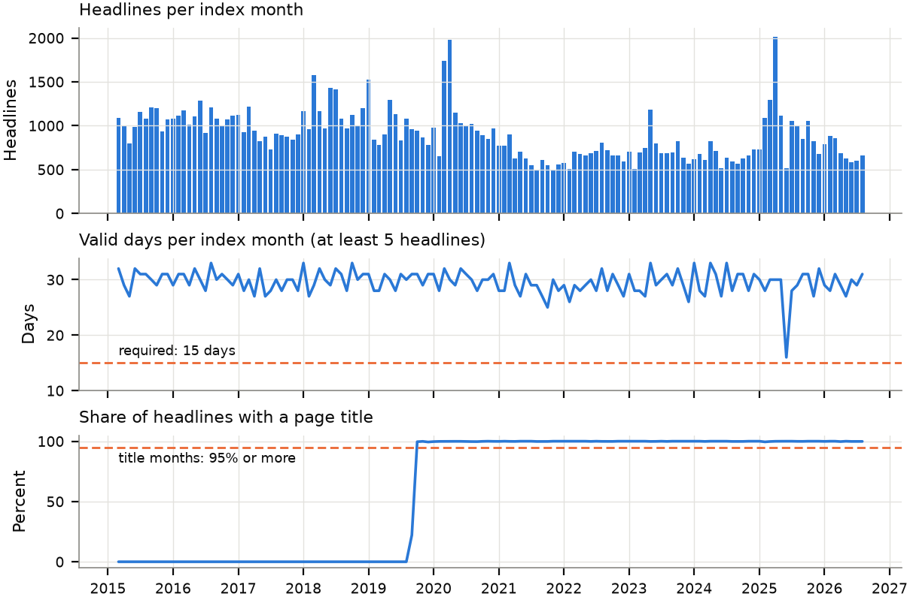
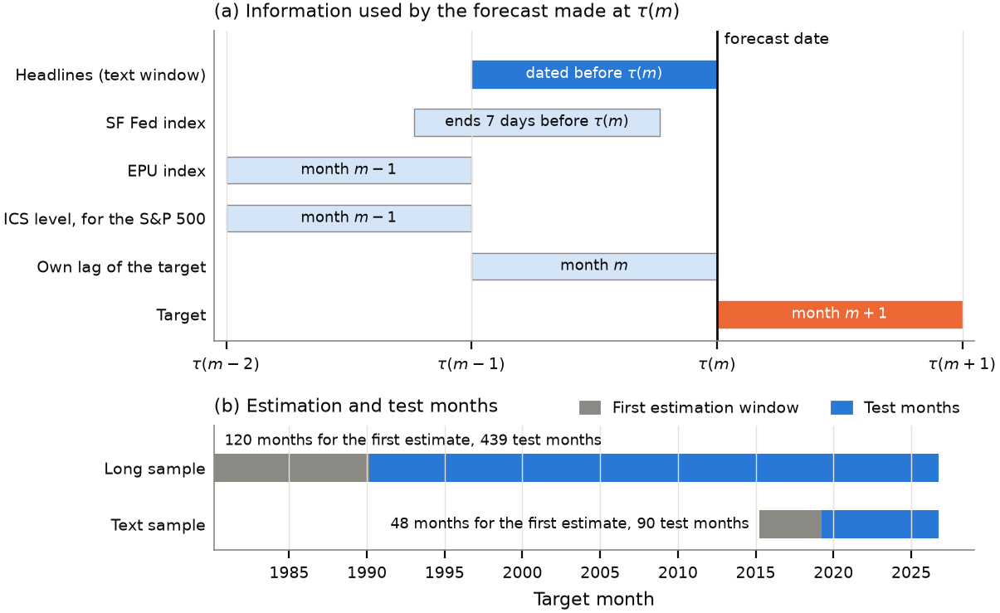
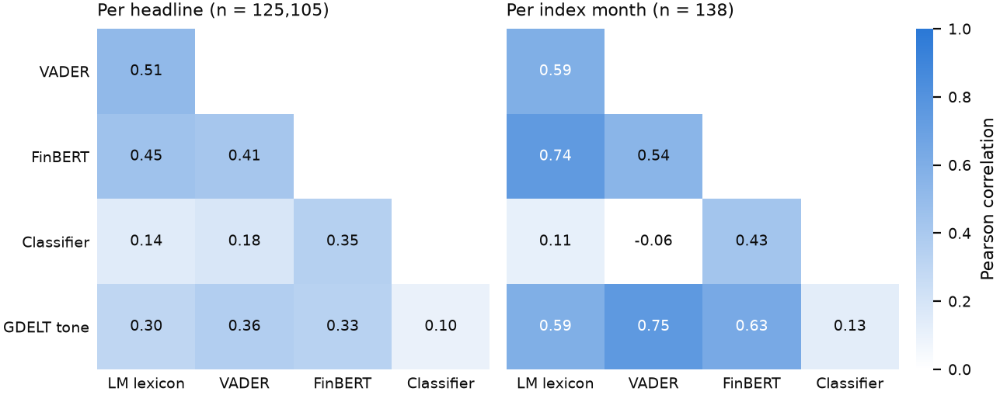
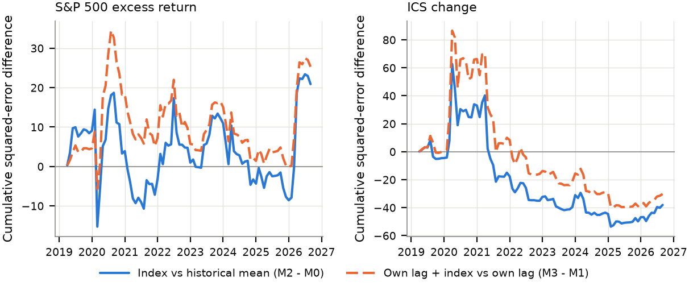
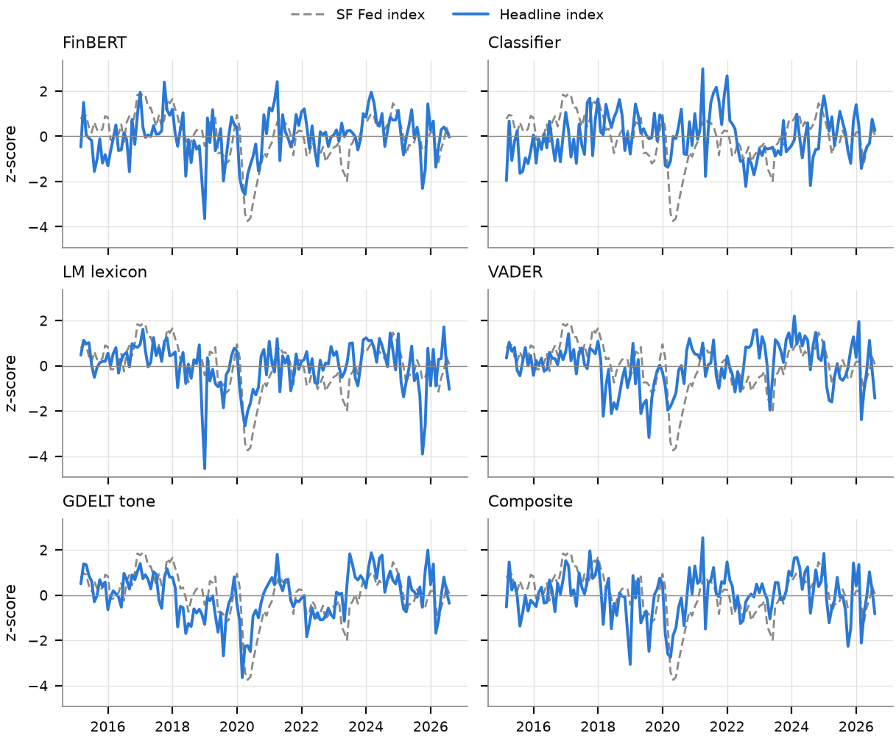
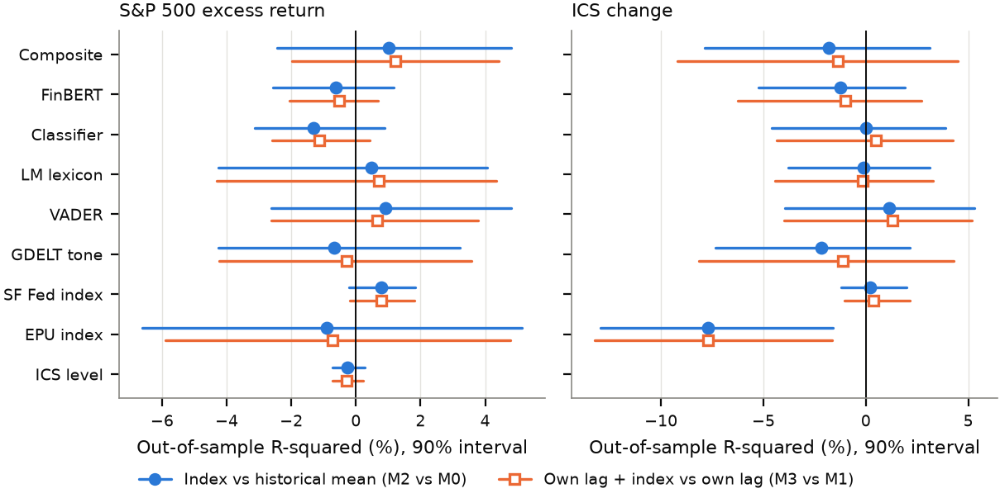
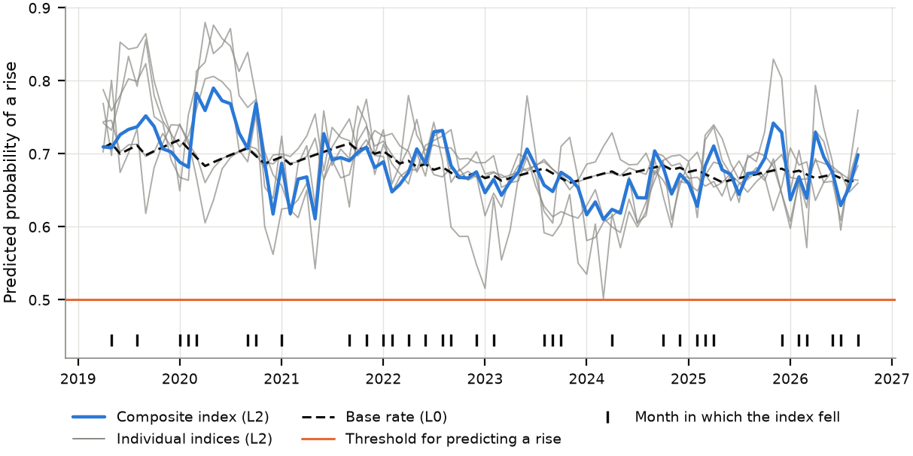

# SentCast

**Sentiment Forecast: does news sentiment predict the S&P 500 and consumer sentiment?**

Does a monthly sentiment index built from free news headlines improve one-month-ahead
forecasts of the S&P 500 excess return, its direction and the change in the University of
Michigan Index of Consumer Sentiment? SentCast answers with a test fixed in advance: the
sample, models, statistical tests and decision rule were written down before any experiment
ran, and all twelve experiments are reported. The result is null for all three targets at
one month.

*Built by Vignesh Nagarajan.*

* **Paper:** *Out-of-Sample Evaluation of Textual News Sentiment for Predicting the Equity
  Premium and Consumer Sentiment* ([`paper/main.pdf`](paper/main.pdf)), 21 pages, 9 tables,
  7 figures, 25 references.
* **Journal:** [Journal of Forecasting](https://onlinelibrary.wiley.com/journal/1099131x) (Wiley), submitted on 10 Nov 2026, in review.

## Functionality

<p align="center">
  
  
  
  
  
  
  
  
  
  
  
</p>

- **Headline corpus:** a seeded draw of two GDELT files a day, 2015 to 2026, with headlines
  rebuilt from article URLs and filtered to US economy and market news.
- **Four scorers and a composite:** the Loughran-McDonald word lists, VADER, FinBERT and a
  classifier trained on the Financial PhraseBank, standardised and averaged; two large
  language models as a secondary comparison.
- **Leakage-checked forecasts:** expanding-window OLS and logit models; tests fail if a
  headline dated on or after a forecast date, or a series without a release lag, enters a
  forecast.
- **Pre-specified evaluation:** out-of-sample R-squared, Clark-West, Pesaran-Timmermann and
  Diebold-Mariano tests, stationary bootstrap intervals, and a decision rule that maps the
  results to positive, mixed or null.
- **Generated paper numbers:** every result in the paper is printed from `results/` through
  `\res{key}` macros, and `sentcast.verify` checks them.

## Figures

Numbered as in the paper.

<table>
  <tr>
    <td width="50%" valign="top"><br><sub><b>Figure 1. Coverage.</b> Headlines, valid days and page-title share by index month.</sub></td>
    <td width="50%" valign="top"><br><sub><b>Figure 2. Timing.</b> What each forecast may use, and the estimation and test months.</sub></td>
  </tr>
  <tr>
    <td width="50%" valign="top"><br><sub><b>Figure 3. Agreement.</b> Correlation between scorers, per headline and per month.</sub><br><br><br><sub><b>Figure 5. Gains over time.</b> Cumulative squared-error difference against each benchmark.</sub></td>
    <td width="50%" valign="top"><br><sub><b>Figure 4. Indices.</b> Headline indices against the San Francisco Fed index.</sub></td>
  </tr>
  <tr>
    <td width="50%" valign="top"><br><sub><b>Figure 6. Out-of-sample R-squared.</b> Point estimates and 90% bootstrap intervals.</sub></td>
    <td width="50%" valign="top"><br><sub><b>Figure 7. Direction.</b> Predicted probability that the S&P 500 rises next month.</sub></td>
  </tr>
</table>

## Repository layout

    SentCast/
    |- config/        <- every parameter, frozen
    |- src/sentcast/  <- pipeline, from downloads to tables, figures and checks
    |- tests/         <- unit tests, including the leakage tests
    |- results/       <- one file per experiment, tables, figures, SUMMARY.md
    |- paper/         <- paper source and PDF; archive/ holds the workshop versions
    |- docs/          <- data check, paper outline
    \- data/          <- downloads and intermediate files; gitignored

`results/` holds values derived from third-party series; the source terms are in
[`docs/data.md`](docs/data.md).

## Run

```bash
pip install -e ".[dev]"
python -m sentcast.run
python -m sentcast.verify --compile
```

`sentcast.run` runs every step from raw downloads to tables and figures; `--help` lists
them. E12 needs `ANTHROPIC_API_KEY` and is skipped without it. E12 reproduces from the
cached labels in `data/interim/`, since a scorer model may be retired.
